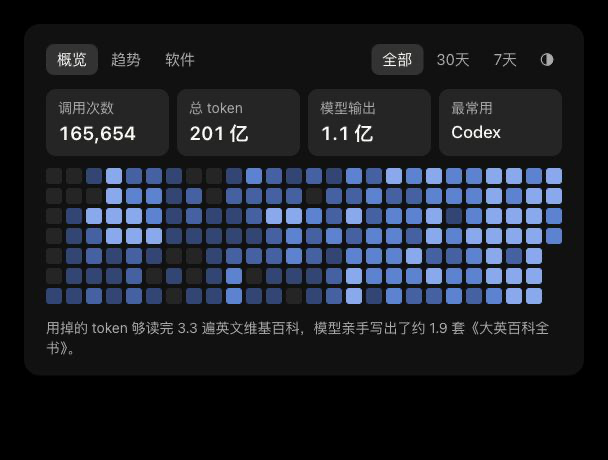
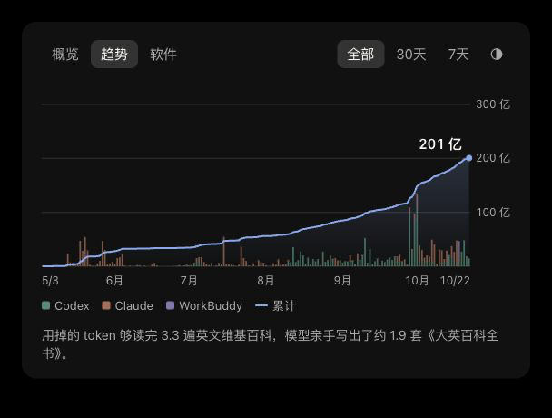
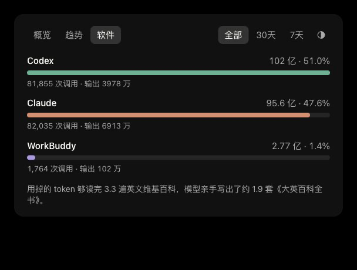

# Tokens · 留住对话，看见用量

扫描本地 coding agent 记录，保存可校验的增量备份，按日统计 token，并生成概览、趋势和软件分布图。支持 macOS、Windows、Linux；主要脚本只依赖 Python 3.9+ 标准库。

原文始终留在本机。这个公开仓库提供工具、工作流和经授权的示例图片，不包含示例对应的原始对话或逐条调用账本。个人备份、配置、报告和生成的统计默认被 Git 忽略。

## 直接交给你的 agent

> 请参考 https://github.com/unryuu/tokens 的 WORKFLOW.md，扫描并备份这台电脑的 coding agent 原始记录，覆盖我指定的工作目录和备份区，统计逐日输入＋输出和模型输出 token，并生成可视化。先检查扫描覆盖范围和备份校验结果；不要上传个人数据。清理重复快照和发布统计需按我的授权执行。

后续在同一个工作区说“帮我备份并更新图表”即可。另一台电脑也执行同样流程；多机共同对账使用你自己的统计仓库，见 [工作流](WORKFLOW.md)。

也可以说“导出 Claude 会话《会话名称》”。导出器保存原话 Markdown、离线 HTML、可展开的工具附录、日志内的图片和原始 JSONL，默认只写入被忽略的 `reports/exports/`。同名会话会先列出供确认；定位规则和完整说明见 [导出流程](WORKFLOW.md#按会话名导出-claude-对话)。

```sh
uv venv .venv                             # 已有虚拟环境时直接使用
uv pip install --python .venv/bin/python -r requirements-export.txt
.venv/bin/python scripts/export_claude.py "会话名称" --list
.venv/bin/python scripts/export_claude.py "会话名称"
```

Windows 将 `.venv/bin/python` 换成 `.venv\Scripts\python.exe`。导出只读取本机记录，不调用模型，不自动上传；支持 Claude Code JSONL。

## 手动运行

```sh
git clone https://github.com/unryuu/tokens.git
cd tokens
python3 scripts/backup.py --scan           # 只扫描，结果留在 reports/discovery.json
python3 scripts/backup.py                  # 增量备份、SHA-256 校验、逐日统计
python3 scripts/backup.py --publish-stats  # 整理本地账本并生成图表，不联网、不提交 Git
```

打开 `statistics/usage-card.html` 即可查看图表，无需安装前端依赖。Windows 使用 `py -3` 替代 `python3`，也可双击 `备份.cmd`；macOS 可双击 `备份.command`。双击入口只负责备份与统计，生成图表继续运行上面的 `--publish-stats`。已有虚拟环境时优先使用其中的 Python。

```sh
python3 scripts/backup.py --verify        # 校验最近快照
python3 scripts/backup.py --report        # 从保留的备份重算本机用量
python3 scripts/backup.py --merge-stats   # 合并已有的多设备账本并重画图
python3 scripts/charts.py                # 仅从已有每日表重画图
python3 -m unittest discover -s tests
```

压缩的 Codex 归档需要 `zstd` 命令、Python 的 `compression.zstd` 或可选依赖 `zstandard`，安装方法见工作流。不会设置定时任务或自动上传。

## 能找到和统计什么

| 来源 | 本地记录备份 | token 统计 |
|---|---|---|
| Claude Code、Codex | 常见会话、归档、相关数据库 | 支持已识别的 usage 格式 |
| WorkBuddy / CodeBuddy | 会话、trace、相关元数据 | 支持会话 usage，trace 不重复计数 |
| Gemini / Qwen、Antigravity、豆包工作模式 | 常见存储路径 | 目前只备份 |
| VS Code / Cursor / Windsurf、Continue / OpenCode / Aider | 常见会话或数据库 | 目前只备份 |

终端、编辑器、桌面端、不同 provider 可能共享记录，也可能使用不同 profile。扫描器探测常见路径、`CODEX_HOME`、`CLAUDE_CONFIG_DIR` 和同名前缀目录；通过被忽略的 `local-sources.json` 补充自定义目录、迁移副本和备份区。WSL 要单独扫描。扫描命中目录不代表其中所有格式都能统计，具体覆盖情况以本地报告为准。

## 备份与去重

备份保留原始 JSONL，SQLite 使用一致性快照。未变化文件在备份快照之间使用硬链接，变化文件保存完整新版本；不与源文件建立硬链接。不要直接编辑快照，使用前先复制。共享存储的逻辑文件大小不等于实际占盘。

统计合并当前记录和保留的历史版本，以调用哈希去重，而不是相加文件或设备总量。Claude 主要按消息 ID，Codex 按原始事件时间与 usage，WorkBuddy 按提供商标识；路径和设备 ID 不参与调用身份。复制项目到备份区或另一台电脑，不会因此重复计算；不同机器实际分别发出的请求仍分别计数。导入工具若重新生成 ID 或修改时间，需要额外核对映射，不能按文字相似擅自扣除。

旧快照清理由 agent 按工作流检查并在授权后移入回收站；脚本不自动删除、不清空回收站。原文没有上传到 GitHub，仍需要外置硬盘或系统备份防范整盘损坏。

## 两种用量口径

**输入＋输出总 token** 包括反复读取的上下文、缓存输入，适合观察累计处理量；热力图和趋势图使用这个口径。**模型输出 token** 只计生成量，可能含推理与工具调用，不等于交付字数或成果价值。日期统一 UTC+08:00，缺失日期归入 unknown。这里统计本地日志留存的用量，不是完整历史账单。

字段定义见 [统计说明](statistics/README.md)，扫描、增量备份、回收站清理、多机对账及图片导出详见 [WORKFLOW.md](WORKFLOW.md)。

## 真实示例

以下图片经仓库所有者授权公开，来自三台设备合并后的记录：2026-05-03 至 2026-10-22，165,654 次调用，输入＋输出 20,067,345,525 token，模型输出 109,925,759 token。界面采用四舍五入显示；类比文案仅帮助感受数量级。

### 概览



### 趋势



### 软件


